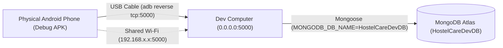

# HostelCare — Physical Android Phone Testing Guide

This guide details the procedure for connecting a physical Android smartphone to your local HostelCare development backend running against the verified development database `HostelCareDevDB`.

---

## 1. Environment Architecture



* **Development Database**: `HostelCareDevDB` on MongoDB Atlas Cluster0.
* **Backend**: Node.js Express server listening on `0.0.0.0:5000`.
* **Android Build**: Debug build (`assembleDebug`) with cleartext HTTP traffic allowed.

---

## 2. Step-by-Step Setup Instructions

### Step 1: Start the Local Backend
In your development computer terminal:
```bash
cd backend
npm start
```
Verify the startup output logs:
```
MongoDB connected successfully to database: HostelCareDevDB
Server running on port 5000
```
> [!NOTE]
> The server listens on `0.0.0.0`, allowing incoming connections from both loopback and local network interfaces.

---

### Step 2: Connect Your Physical Android Phone

#### Option A: USB Cable via `adb reverse` (Recommended — Fastest & Most Reliable)
1. On your Android phone, enable **Developer Options**:
   * Open *Settings* > *About phone* > Tap *Build number* 7 times.
2. In *Settings* > *Developer options*, enable **USB Debugging**.
3. Connect your phone to your PC via a USB data cable. Allow the USB debugging authorization prompt on your phone screen.
4. Verify your phone is detected:
   ```bash
   adb devices
   ```
5. Forward port 5000 from your phone to your PC:
   ```bash
   adb reverse tcp:5000 tcp:5000
   ```
6. Verify the reverse port forwarding rule:
   ```bash
   adb reverse --list
   # Output: (reverse) tcp:5000 tcp:5000
   ```
With `adb reverse` active, the phone routes requests sent to `http://127.0.0.1:5000/` directly to your PC's port 5000!

---

#### Option B: Local Wi-Fi (Wireless)
If you prefer testing over Wi-Fi without a cable:
1. Connect both your PC and Android phone to the **same Wi-Fi network**.
2. Find your PC's local LAN IP address on Windows:
   ```powershell
   ipconfig
   # Look for "IPv4 Address" under your active Wi-Fi adapter (e.g. 192.168.1.45)
   ```
3. Allow port 5000 in Windows Defender Firewall:
   ```powershell
   New-NetFirewallRule -DisplayName "HostelCare Backend Port 5000" -Direction Inbound -LocalPort 5000 -Protocol TCP -Action Allow
   ```
4. Test connectivity from phone: Open Chrome on your phone and browse to `http://<YOUR_PC_IP>:5000/`. You should see `{"message":"HostelCare backend is running"}`.

---

### Step 3: Build & Install the Debug APK

Build the debug APK targeting your connection method:

* **For Option A (`adb reverse`):**
  ```bash
  ./gradlew assembleDebug -PbackendUrl="http://127.0.0.1:5000/"
  ```

* **For Option B (Wi-Fi LAN IP):**
  ```bash
  ./gradlew assembleDebug -PbackendUrl="http://<YOUR_PC_IP>:5000/"
  ```

* **For Android Emulator (Default):**
  ```bash
  ./gradlew assembleDebug
  # Uses default http://10.0.2.2:5000/
  ```

Install directly onto your connected phone:
```bash
adb install -r app/build/outputs/apk/debug/app-debug.apk
```
*APK Location:* `app/build/outputs/apk/debug/app-debug.apk`

---

## 3. Test Credentials (`HostelCareDevDB`)

Use these pre-configured development accounts to test all three portals:

| Portal | Role | Email | Password / ID | Notes |
| :--- | :--- | :--- | :--- | :--- |
| **Student Portal** | Student | `sahil.student@gmail.com` | `Password123!` (Student ID: `STU101`) | Block: Tagore Block B, Room 204 |
| **Student Portal** | Student | `sahilku707@gmail.com` | Production password (Student ID: `12305507`) | Block: B, Room 927 |
| **Warden Portal** | Warden | `warden@hostelcare.com` | `Password123!` | Campus Hostel, Block B |
| **Staff Portal** | Staff | `staff@hostelcare.com` | `Staff123!` (Staff ID: `STF-101`) | Department: Plumbing |

---

## 4. End-to-End Verification Flow on Phone

1. **Student Login**:
   - Open HostelCare app on phone > Tap **Student Portal**.
   - Log in with `sahil.student@gmail.com` / `Password123!`.
   - Submit a test complaint (e.g. Title: *"Ceiling fan not working"*).
   - Confirm complaint appears in your student list.
   - Log out.

2. **Warden Portal**:
   - Tap **Warden Portal** > Log in with `warden@hostelcare.com` / `Password123!`.
   - Verify newly submitted complaint appears on Dashboard and Complaints List.
   - Tap into complaint detail: Verify **Student Name**, **Student ID (`STU101`)**, **Hostel**, **Block**, and **Ticket ID** are clearly separated and labeled.
   - Tap **Assign Staff** > Select `Ramesh Sharma (Plumber)`.
   - Tap **Update Status** > Change to `in_progress`.
   - Log out.

3. **Staff Portal**:
   - Tap **Staff Portal** > Log in with `staff@hostelcare.com` / `Staff123!`.
   - Verify the assigned complaint appears in Staff task list.
   - Update status to `resolved` with a note.

---

## 5. Troubleshooting Connection Failures

| Issue | Cause | Fix |
| :--- | :--- | :--- |
| `java.net.ConnectException: Connection refused` | `adb reverse` rule expired or backend not running | Run `adb reverse tcp:5000 tcp:5000` and ensure `npm start` is active. |
| `CLEARTEXT communication to ... not permitted` | Release build without HTTPS | Ensure you are testing a **Debug** build (`app-debug.apk`), which enables `android:usesCleartextTraffic="true"`. |
| `SocketTimeoutException` on Wi-Fi | PC firewall blocking port 5000 | Add inbound firewall rule for port 5000 or switch to USB cable with `adb reverse`. |
| `403 Forbidden - Role mismatch` | Logging into the wrong portal | Ensure you select the portal corresponding to the account's role. |
